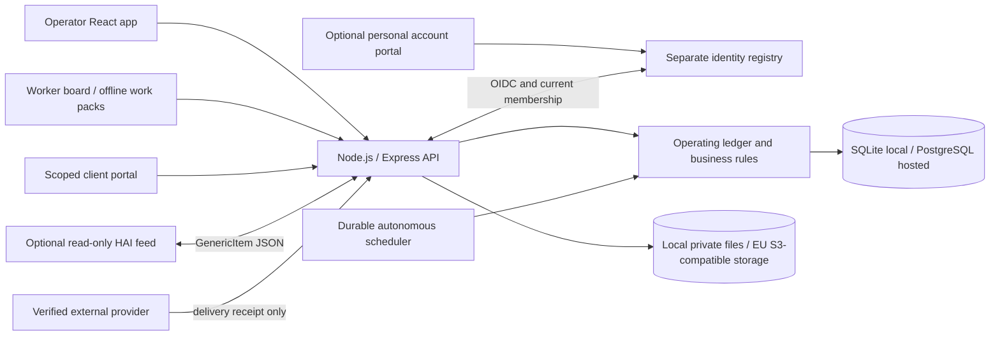

# Contractor.AI

[](https://github.com/Robert-Velhorst/002-Contractor-AI/actions/workflows/verify.yml)

Contractor.AI is a local-first construction operations platform for contractors
in the Netherlands and wider Europe. It brings the contractor's office, the
executing crew, and the client into one auditable workflow: from incoming work
and estimating to field execution, evidence, change control, and handover.

It is not a marketing demo or a collection of disconnected prototypes. The
product runtime is a Node.js 26.x application with an Express API, a React/Vite
interface, a transactional SQLite or PostgreSQL ledger, and private evidence
storage. SQLite and local files support local operation. Hosted mode requires
configured PostgreSQL, private EU object storage, strong authentication, HTTPS
ingress, and retained provider and recovery evidence. Passing local or CI checks
does not prove a live EU deployment is configured or accepted.

> **Important:** Contractor.AI prepares and governs work; it does not silently
> send external messages, place orders, commit dates, submit financial claims,
> initiate payments, or certify legal or safety compliance. External actions
> require a configured, verified integration and the required human approval.

## Product Overview

Contractor.AI serves three groups through connected experiences:

| Experience | Typical work |
| --- | --- |
| Contractor / office | Intake, estimating, project control, approvals, workforce and resource planning, procurement, finance evidence, client updates, and closeout. |
| Executing worker / subcontractor | Approved positions, assignment requirements, shared instructions, online/offline work packs, safety and quality records, progress, time, materials, and evidence. |
| Client | Scoped project conversations, shared photos and details, questions, approval-gated delivery reviews, and recorded replies or reservations. |

The product links those activities to retained jobs, tasks, work packages,
evidence, revisions, decisions, and an audit history. Availability depends on
user role, source freshness, configuration, and approval status; a screen or
adapter is not proof that an external provider is live.

| Area | Implemented workflow examples |
| --- | --- |
| Commercial | Opportunities, surveys, bids, takeoffs, estimates, contracts, variations, purchase orders, and cost forecasts. |
| Delivery | Schedules, work packages, dispatch, attendance, field reports, inspections, work balance, partial deliveries, and handover. |
| People and resources | Worker registration and admission, qualifications, availability, equipment custody, stock, supplier records, and disruption recovery. |
| Client service | Retained conversations, explicitly shared evidence, client responses, delivery reviews, aftercare, and installed-asset history. |
| Finance controls | Cost and cash-flow forecasts, invoice and expense evidence, credit notes, and approval-backed handoffs; no payment execution or payroll. |
| Governance | Role boundaries, approvals, audit history, privacy requests, backup/restore, migration, readiness checks, and bounded internal automation. |

### Runtime At A Glance

- **Local:** Node.js 26, Express, React/Vite, SQLite, and private local files.
- **Hosted:** PostgreSQL and private S3-compatible EU storage, HTTPS, strong
  authentication, explicit proxy/CORS configuration, and retained recovery and
  provider evidence. Hosted startup fails closed when requirements are absent.
- **API:** `/api/ledger/*` is the authoritative product API.
- **Automation:** drafts and internal checks only by default. External messages,
  spend, date commitments, finance actions, and submissions remain approval- and
  integration-gated.

Contractor.AI is under active development. Local and CI verification do not by
themselves establish hosted production readiness, regulatory compliance,
professional certification, or customer/operator acceptance. The currently
published version is a **release candidate**, not a stable or production-ready
release. See [Release status](#release-status),
[Current Boundaries](#current-boundaries), and the
[delivery register](docs/TOTAL_SOLUTION_DELIVERY.md).

## Release Status

The first public package is published as **Contractor.AI 1.1.0-rc.1**. It is
intended for evaluation and local installation; it is not a claim that an EU
hosted service, WhatsApp integration, or production operation has been accepted.

- [Release notes and downloads](https://github.com/Robert-Velhorst/002-Contractor-AI/releases/tag/v1.1.0-rc.1)
- [Windows x64 standalone package](https://github.com/Robert-Velhorst/002-Contractor-AI/releases/download/v1.1.0-rc.1/ContractorAI-windows-x64.zip)
- Container image: `ghcr.io/robert-velhorst/002-contractor-ai:v1.1.0-rc.1`
- The Windows archive passed the release workflow's package smoke test; the
  container build and registry publication also completed successfully.

The release is a prerelease. No stable `v1.1.0` release is being represented
here. Review the release notes and this README before installing, and keep
production data out of evaluation deployments.

## Contents

- [Product overview](#product-overview)
- [Release status](#release-status)
- [Current product examples](#current-product-examples)
- [The short version](#the-short-version)
- [Who it is for](#who-it-is-for)
- [What the product covers](#what-the-product-covers)
- [How a job moves through the system](#how-a-job-moves-through-the-system)
- [Roles and access](#roles-and-access)
- [Automation and safety model](#automation-and-safety-model)
- [Architecture](#architecture)
- [Runtime modes](#runtime-modes)
- [Quick start](#quick-start)
- [Release package](#release-package)
- [Daily operation](#daily-operation)
- [Configuration](#configuration)
- [Data, evidence, backup, and restore](#data-evidence-backup-and-restore)
- [API contract](#api-contract)
- [Security and privacy](#security-and-privacy)
- [EU-hosted production](#eu-hosted-production)
- [Development workflow](#development-workflow)
- [Verification and CI](#verification-and-ci)
- [Repository map](#repository-map)
- [Documentation index](#documentation-index)
- [Current boundaries](#current-boundaries)

<details>
<summary>Revision-specific implementation examples</summary>

## Current Product Examples

The following notes describe implementation changes and measured test fixtures,
not broad performance guarantees or live production acceptance. Their evidence
is revision-bound; consult the linked acceptance and verification records.

**Lighter qualification and availability interaction:** qualification workers now
use the existing 10/25/50-row pagination, rather than rendering every loaded
worker at once. Qualification and availability searches reuse their original
JSON search representation within the mounted view while search is active.
Unchanged visible qualification rows are reused during typing; refreshed
credentials, permissions, language and action callbacks still update them.
The production-UI 500-worker fixture types 46 characters without repeating row
render work or issuing business commands and opens the exact 500th worker's
evidence editor. This preserves the register's default 500-worker loading cap
and does not paginate job requirements or claim whole-browser RAM/latency gains.
See the [acceptance-test register](docs/ACCEPTANCE_TESTS.md) for required release
evidence. The [verification report](docs/FINAL_VERIFICATION_REPORT.md) contains
dated checkpoints; it is not a live status page, and results apply only to their
stated revision.

**Lighter client-directory interaction:** the loaded client register renders 25
rows by default, with 10/25/50-row pages. Search normalizes its eight existing
fields once per loaded array during an active search; unchanged matching rows
are reused while typing. New records, language, edit authority, busy state and
callbacks still update the view. Pagination uses the same controls as the crew,
equipment, partner and receipt registers. This does not change the existing
500-client API loading limit or claim universal latency/RAM gains. See
the dated [verification checkpoints](docs/FINAL_VERIFICATION_REPORT.md) for
measured checks; they apply only to the stated revision.

**Clearer field-safety history:** an active stop-work assessment now explicitly
requires reassessment instead of appearing to expire by itself. Superseded
assessments remain visible as history, and the stop-work badge is translated in
Dutch. The safety rows also have stronger text contrast. This changes display,
not authorization: only the live ledger can validate current safety sources.
Production bundling reuses the installed React automatic JSX runtime without
replacing its behavior. This changes display and build wiring, not authorization
or field safety decisions. Hosted production acceptance remains a separate gate.

**Safer disruption recovery:** six recovery forms now share a synchronous write
lock and retain uncertain requests for an identical retry. Supplier forms stay
mounted while a parent write is in progress and when their panel is collapsed.
Actual-cost allocations and corrections survive a lost response and reload
without creating a second allocation; stock retries recheck edit rights. The
cash-flow control waits for the first forecast before exposing editable defaults
or totals. These are local behavior fixes, not autonomous spending, new external
integrations or production acceptance.

**Safer release checks:** the browser runner binds its results to the exact built
files, packaged runtime closure, application sources and browser tests. A change
during a run stops verification instead of mixing results from different builds.
Browser and canonical Node test children discard inherited operator credentials,
operator storage paths, provider settings and Node preloads, force local loopback operation
and disable external channels. Each Node test process has unique temporary default
storage; solver/build threads retain their parent fixture's storage. Only an
explicitly guarded disposable PostgreSQL URL and its configured CA are retained.
Use `npm test` for these controls; direct `node --test` bypasses the wrapper.
This is environment hygiene for trusted repository tests, not a security sandbox.
Results and screenshots
stay outside the repository. See the [acceptance tests](docs/ACCEPTANCE_TESTS.md)
and dated [verification checkpoints](docs/FINAL_VERIFICATION_REPORT.md). These
checks do not replace production hosting or live-provider acceptance.

**Safer offline documents:** drawings, safety sheets and approved technical PDFs
share one bounded download verifier. It checks the retained size, PDF signature
and SHA-256 before saving; truncated, changed or oversized streams are rejected.
The online work pack loads the download and encrypted-vault modules only when
needed. Saving freezes the passphrase and rejects simultaneous submissions;
the live source is rechecked before retention. This improves first-use loading
and robustness, not the aggregate release-size budget or production acceptance.

**Interrupted replacement plans:** the job recovery workflow now freezes the
selected workers and reason while saving. If the response is uncertain, it
retains the exact request in the existing operator- and source-scoped session
draft and offers an identical retry, including after reopening the same current
draft. A confirmed rejection unlocks correction without losing the selections.
Closed, cancelled or stale recovery cases cannot initiate these child actions.
The ledger still requires independent approval; retrying does not create a
second pending plan or change the existing assignments.

**Total-solution build:** the accepted scope and remaining acceptance gates are
tracked in [the delivery register](docs/TOTAL_SOLUTION_DELIVERY.md). The
[company-environment foundation](docs/COMPANY_ENVIRONMENTS.md) now binds databases,
private directories, browser requests/downloads, sessions, backups and separate
encrypted offline work folders to their own environment. An optional
[shared account service](docs/IDENTITY_AND_MEMBERSHIP.md) now supports personal
registration, company invitations, owner-reviewed admission, account recovery
and switching between separately authorized companies through OIDC. This is
locally tested implementation, not a live hosted identity service or a complete
autonomous planning system.
Registry administrators also have [encrypted recovery and key-rotation commands](docs/IDENTITY_RECOVERY.md).
A restored registry retains its history, but does not revive passwords, sessions
or company admission; access requires reviewed recovery and new admission.

**New local workflow:** worker self-registration, owner admission and selectable
project positions are available at `/work-board.html`. See the
[work-board guide](docs/WORK_BOARD.md) for setup, automatic internal placement,
privacy boundaries and remaining public-launch requirements.

**Shared work dossier:** office users can retain reusable physical locations,
job-specific parties and versioned work packages linked to existing tasks and
quantity measurements. Assigned workers receive the relevant instructions and
explicitly shared site contacts online and in their encrypted offline work pack.
Package-linked positions stop new placement when the retained source changes.
See [Shared Work Model](docs/SHARED_WORK_MODEL.md); this does not establish
resource-feasible scheduling, safety clearance, client acceptance or payment.

**Partial work deliveries:** a separately described portion can now link existing
production measurements or completed-task reports to inspections, a reviewed
customer response and billing milestones. The four states stay separate; pending
payments, credit/write-offs, reservations and disputes are not silently treated
as completed or paid work. Corrections preserve history. Field/offline views omit
private customer and financial evidence. See [Partial Work Deliveries](docs/WORK_DELIVERIES.md)
for the workflow, API, privacy controls and remaining closure work.

Installed components now retain manufacturer/model/serial identity and
source-linked work history across jobs. Replacement preserves the old and new
units separately. Existing warranty, aftercare and recurring plans can be linked;
an internal maintenance draft inherits its installations and preparation tasks.
Only explicitly shared operational summaries reach assigned field/offline packs.
This is not a safety release, warranty entitlement or confirmed maintenance visit.
See [Installed Asset History](docs/INSTALLED_ASSET_HISTORY.md).

Inspection coverage now records a reviewed list of required checks for each
reported work portion, then an independently reviewed mapping to existing
inspection evidence or permitted non-applicability. Scope/evidence changes make
coverage stale; revisions never inherit old approval automatically. Assigned
workers receive operational instructions and status online/offline, not private
review files. This is coverage of the declared control plan, not certification
of safety, legal completeness or permission to use an installation.
See [Inspection Coverage](docs/INSPECTION_COVERAGE.md).

Office users can also offer a defined executed portion through an approved
client portal, with explicitly reviewed public scope and existing shared photos.
The client responds with acceptance, reservations or a dispute and an optional
photo. The reply joins the conversation and existing delivery-review queue;
identity/authority still require office verification. Link expiry, withdrawal and
changed evidence block new reliance without deleting history. No whole-job
closure, safe-use permission or external message follows automatically.
See [Client Partial-Delivery Responses](docs/CLIENT_DELIVERIES.md).

**Work balance:** an office operator can split every approved production
quantity across task-bearing work packages and submit that immutable allocation
for a separate approval. Reported production reduces package remainder only
after it is linked to a current retained delivery. Stale sources, open corrections,
overproduction and unallocated output stop a new position from being published.
Field workers see a limited remaining-scope projection, not private source or
customer data. This does not auto-schedule crews or make date commitments. See
[Work Balance](docs/WORK_BALANCE.md).

</details>

## The short version

For an owner or project team, Contractor.AI provides one place to answer:

- Which opportunities should we pursue, and why?
- What scope, quantities, risks, price, and programme have we retained?
- Which decisions still need a named human approver?
- Are the correct people, tools, documents, materials, and permits ready?
- What happened on site, who recorded it, and what evidence supports it?
- Which costs, commitments, invoices, payments, and forecasts are recognized?
- What has the client seen, accepted, rejected, or asked to change?
- Can we prove the history without rewriting earlier records?
- What can the system safely draft next without making an external commitment?

For a developer, the defining rules are:

1. `server.js` is the HTTP and runtime boundary.
2. `operating-ledger.js` owns durable business rules and migrations.
3. `/api/ledger/*` is the authoritative product API.
4. `App.jsx`, `WorkBoard.jsx`, `OfflineField.jsx` and `ClientPortal.jsx` are the
   office, worker, offline and client interfaces. The optional `IdentityPortal.jsx`
   runs on a separate identity-service origin, not inside a company ledger.
5. SQLite plus local files is the default local mode.
6. PostgreSQL plus private S3-compatible storage is the hosted mode.
7. Audit, approval, idempotency, source hashes, and provider receipts are part
   of the business contract, not optional logging.

## Who it is for

Contractor.AI is designed for small and medium contractor organizations that
need operational discipline without starting with a large cloud rollout.

| User | Typical use |
| --- | --- |
| Owner / director | Business identity, risk, approvals, team access, recovery, audit, and performance |
| Estimator / office operator | Intake, takeoff, estimating, scope, tendering, planning, procurement, and finance evidence |
| Approver | Independent review of retained decisions and their exact effects |
| Site manager / field worker | Assigned work, safety controls, progress, evidence, attendance, materials, and daily records |
| Client | A narrow, expiring, approval-gated project portal |
| Developer / operator | Local deployment, migration, diagnostics, integration, and release verification |

It is **not** a payroll system, bank, certified accounting package, Peppol access
point, emergency service, statutory safety register, legal adviser, or automatic
AI decision maker. It can prepare controlled handoffs to those domains, but the
real provider, legal, and professional acceptance work remains external.

## What the product covers

The interface has fourteen navigation destinations: **Today, Pipeline, Jobs,
Schedule, Approvals, Dispatch, Disruptions, Resources, Finance, Performance,
Clients, Field, Operations,** and **Help**. Access is filtered by role.

### Interactive performance

<details>
<summary>Implementation and benchmark details</summary>

- Loading-list recommendations count tools and materials independently instead
  of multiplying their joined rows. Job-scoped covering indexes are installed
  by forward migration `096_loading_read_indexes`, for SQLite and PostgreSQL.
  Existing plans, resource statuses, null-ID behavior and the five-job limit
  retain their semantics; equal update times now use a stable ascending job ID.
  This is a read optimization, not automatic procurement, dispatch or sending.
  Controlled scale measurements and storage tradeoffs are recorded in
  [the performance benchmark](docs/PERFORMANCE_BENCHMARK.md).
- Production tab loaders omit JavaScript preload references only when the
  importer's exact static module graph already guarantees that code is loaded.
  New child/shared modules, CSS, unknown paths and HTML preloads remain intact.
  This removes redundant loader bookkeeping, not 380 proven network downloads.
  The build policy and installed Vite version contribute to dynamic-chunk names
  before finalization, preventing changed code from reusing cached filenames.
  Custom/disabled preload policies, debug maps, SSR, library and non-ES output
  bypass filtering. No runtime dependency is added. Current whole-build savings
  are modest: 533 gzip and 430 Brotli bytes; the seven download gates remain open.
- Dashboard and capability counts avoid deduplication where a record can join
  at most one project. Requests can join multiple projects and still count only
  once. Null IDs, inactive projects, global records, filters and approval rules
  retain their previous behavior. This reduces recalculation work without adding
  browser code or changing cache authority. Controlled measurements, complete
  SQLite/PostgreSQL checks and remaining performance limits are recorded in
  [the verification report](docs/FINAL_VERIFICATION_REPORT.md).
- Forty-two operator action forms share an on-demand module rather than being
  part of the dashboard startup code. This includes crew, availability,
  equipment, trade partners, approvals, client records, takeoff, commercial and
  procurement actions, receipts, invoices, field reviews and resource planning.
  Their existing fields, validation, callbacks and parent-owned drafts remain
  intact. A shared loading/error boundary keeps the dashboard available and
  lets the operator close before loading finishes without a late form mount;
  this does not abort the underlying module download. The first of these forms
  loads the shared module; subsequent forms reuse it. Finance/resource action
  forms and intake retain their separate loaders; the dossier and offline field
  routes are unchanged.
  This reduces initial dashboard code, not the total code needed for every
  feature; whole-build budgets still count the deferred module.
- Production builds also minify Vite's dependency-loading helper, which is
  inserted after normal chunk minification. Only dynamic-import ESM chunks are
  reconsidered; a replacement must shrink both raw/gzip bytes and not grow the
  selected Brotli body. Module paths, exports and chunk metadata are preserved.
  Compiler settings and compiler/Node/compression versions contribute to cache
  identity before filenames are finalized. Debug maps, alternative minifiers,
  SSR and library builds bypass this optimization. There are no new runtime
  dependencies or unsafe coercion/property-mangling options. The saving is small
  and the production build takes longer; this is a build-time tradeoff, not a
  claim of substantially faster navigation or closed download budgets.
- Production builds choose the smaller Brotli representation per JavaScript/CSS
  file from quality 10 and 11, without changing the decoded application code.
  Express reuses those files for normal browser encoding preferences instead of
  recompressing them for each request. Explicit gzip/identity preferences and
  disabled Brotli remain respected. This saves transfer and server compression
  work; it is not a guarantee of instantaneous rendering or total-browser RAM.
- The production translation catalogue orders retained literal keys during the
  build without renumbering existing compact tokens. All referenced Dutch/English
  labels and variable substitutions are checked against the original catalogue,
  including the actual served module. Unknown prototype-like keys use literal
  fallbacks instead of crashing interpolation. Non-literal evaluation order is
  preserved. Whole-build measurements, not one smaller module, decide whether a
  compression experiment is retained; the latest saving is modest.
- Client-delivery forms reuse the current retained-history and photo-choice
  views while unrelated fields are typed. Data refresh, role, language, time zone,
  selected photos and action gates invalidate the affected view. Candidate
  blocking uses one active-offer index; older conversation-photo pages merge with an identity
  set while retaining incoming precedence and order. Approval, source review,
  cancellation and the ten-photo selection limit are unchanged. These scoped
  CPU-work reductions are not a lower aggregate-download or total-RAM claim.
- Customer delivery responses also reuse unchanged offer/response photo lists
  while fields are typed. The office and customer share one small list component
  beside the existing authorized photo viewer. Fresh list identity, private
  conversation path, client token or language invalidates that instance's view.
  Preview leases, read queues, original-download checks and independent approval
  remain unchanged. This avoids repeated photo-element work, not live-provider
  or whole-browser memory proof; every shared dependency still counts in budgets.
  Ordinary response fields use the shared 180 ms quiet-interval draft flush and
  immediate page-hide recovery rather than scanning/writing storage per keystroke.
  Frozen send attempts and acknowledged photo receipts are still saved immediately.
- New recovery-case input reuses unchanged source rows and existing case views.
  Selected sources use separate type/id indexes rather than nested scans. Fresh
  data, permissions, time zone, job navigation and command locks still update
  the affected controls. Closing or refreshing cancels obsolete reads, not
  submitted writes; exact uncertain retries and approval gates remain intact.
  Current component and real-ledger browser checks show no repeated source/case
  reads while typing. This trades current render references and a small code-size
  increase for less repeated CPU work; it does not close the size budgets.
- Editing an existing recovery instruction or closure note also reuses that
  case's unchanged source-impact list. New source-array identity, material
  navigation authority and the current time zone invalidate it. Date formatting
  is scoped to the mounted case and current zone, not a global data cache.
  Blockers, report selections, command hashes and submission checks still update
  independently; this does not change work instructions or schedules by itself.
- Finance and resource action forms use separate cached, on-demand modules.
  Their fields, validation, draft ownership and approval handlers remain unchanged.
  Opening the dashboard or the Finance screen does not download either form;
  opening one form does not download the other. Closing during loading prevents
  a late form mount, without aborting the underlying module download. A loading
  failure stays inside the dialog instead of replacing the dashboard.
  This reduces startup code, not the total code needed for every feature.
- Acquisition, bid comparison, portfolio scheduling and dispatch have separate
  cached screen loaders instead of being part of the startup dashboard code.
  Navigation intent can warm acquisition, schedule or dispatch code without
  ledger reads. Bid comparison loads only when that subview is opened, with a
  local loading boundary that keeps the pipeline tabs available. Scheduling
  continues to use the company's existing request routine for preview and
  independent approval; no automatic assignment or external commitment is added.
- Recovery cases index task-blocker sources once when checking selected worker
  resumption reports, instead of repeatedly scanning the full source list.
  Material summaries read each quantity once while retaining category order,
  units and the explicit unavailable-inspection status. Completion evidence and
  approval gates are unchanged.
- Recovery cases index the latest field instructions in retained order once per
  render. Material inspection evidence renders directly from its source lists,
  without allocating intermediate review records. Dates in a case share a
  lazily constructed formatter for that render only; refreshing captures the
  current system time zone instead of retaining a global time-zone snapshot.
- Pointing to or focusing selected navigation destinations warms their screen
  code, one module at a time, without reading ledger data. Offline, data-saving
  and detected 2G connections disable this speculative loading.
- Clients, automation and capability setup have independent cached module
  loaders. Opening Clients or Operations no longer evaluates the aggregate
  dossier-control JavaScript (planning, takeoff, production and other job
  controls). Shared styles remain common, and the original named component
  exports remain available for existing imports. This reduces first-navigation
  work, not the download required to use every feature.
- The twelve dossier controls also have independent cached loaders: takeoff,
  production, daywork, commercial scope, project records, photographs,
  inspections, nonconformances, field risks, closeout, field assurance and work
  planning. The field-assurance queue no longer imports those other controls.
  Existing `JobWorkspaceControls` named exports remain available as a
  compatibility module. Shared price-display helpers and styles are not copied.
  Production groups the eleven controls rendered together by the dossier into
  one compressed chunk; field assurance remains separate. Opening all dossier
  sections still loads their controls, not only the currently visible tab.
  This is not a claim that the complete dossier needs less code overall.
- Switching primary screens cancels obsolete navigation reads. The mobile menu
  stays available during loading; data-dependent content remains protected until
  its fresh read completes. Explicit refresh does not reuse an aborted signal.
- The daily workbench and the work-context, work-delivery, asset-history,
  inspection-coverage, work-balance, operational-recovery and client-delivery panels also cancel their
  abandoned effect reads. Client-offer photo reads stop when the offer closes.
  Late results and failures cannot overwrite the replacement screen. Save and
  approval commands remain independent: navigation does not abort or replay a
  write. These controls share one read helper, counted in each dependent
  surface's download measurement rather than hidden from its budget.
- Resource-view reads start without the previous fixed 120 ms delay. A full
  refresh of the job register reuses the fresh jobs response rather than fetching
  the same first page twice.
- Detailed health and readiness reads run when Operations is opened or refreshed,
  instead of blocking every dashboard start and unrelated refresh. Until that
  read succeeds, the interface does not claim readiness. Server-side readiness,
  authorization and approval enforcement are unchanged.
- Typing an unsubmitted job search does not redraw its unchanged result table.
  A fresh first-page response preserves typed search text and cancels any search
  response based on the previous source. Parent locale and authority changes
  still update the result renderer.
- Intake input is owned by the form, not the dashboard: typing does not rerender
  sibling workspaces. The same operator-scoped session draft keys are retained
  across closing and reload. Failed saves keep input; confirmed saves clear it
  and refresh the ledger. Pending saves block edits and duplicate submission.
- Crew, equipment, trade-partner and material-receipt searches reuse in-memory
  search text while their source rows remain unchanged. Results stay paginated;
  a changed source array rebuilds the index. No approval or safety decision is
  cached by this optimization.
- Opportunity and bid-package searches reuse the exact normalized dossier JSON
  for the current source rows and status filter, instead of serializing nested
  records on every keystroke. No index is built for an empty search or the hidden
  opportunity view. Clearing search releases its retained search-text references;
  changed sources/filters rebuild them. Nested fields, case/space handling,
  ordering and original detail-selection objects remain unchanged. This trades
  temporary search-text memory for less repeated CPU work, not a browser RAM cap.
- Private conversation photographs load near the viewport as small, static,
  authorized previews, capped at 960 pixels per edge and 512 KiB. Full originals
  download only on an explicit icon action and retain their original bytes and
  checksum. The download remains available if a legacy photo cannot produce a
  preview. Browser body reads are limited to two at a time, with priority for
  explicit downloads; cancelled screens do not leave queued reads running.
- A shared image service validates actual JPEG/PNG/WebP content and rejects
  malformed images and images exceeding 64 million pixels or 16384 pixels per
  edge. One conversion runs at a time, with four admitted unique jobs, 32 MiB
  queued/active encoded input and an 8 MiB/64-entry/five-minute preview cache.
  Identical inputs share conversion work. Preview metadata is stripped and only
  the first frame is rendered; original evidence is not rewritten. Both original
  and preview reads recheck access and checksums rather than trusting the cache.
  These limits do not bound all application RAM.
  See [the private photo policy](docs/CONNECTED_EXPERIENCES.md#private-photo-resource-policy).
- Conversation viewers share at most eight active preview leases per document.
  Offscreen previews are aborted, removed and their object URLs revoked; the
  reserved frame remains stable. Returning to a photo makes a fresh authorized
  read. An explicit original download continues if only its preview leaves view.
  Waiting photos can be selected through a localized photo icon without raising
  the limit. Without the observer API, the same ceiling/manual selection still
  works, but geometric offscreen release does not. This does not bound total
  browser RAM, downloaded copies, offline vaults or explicitly opened image tabs.
- Worker-profile fields derive their initial values from the current account
  without a delayed initialization effect overwriting the first fast edit.
  Local edits remain tied to that account and their exact profile source;
  registration and admission checks are unchanged.
- Draft maintenance scans stored drafts once per write, preserving expiry,
  storage limits, secret filtering and operator scope. Storage write errors
  retain the previous draft instead of deleting it first.
- In local SQLite mode, durable API/login counters no longer invalidate an
  otherwise unchanged dashboard summary. Business transactions still invalidate
  it, including nested transactions. SQLite connection changes are checked with
  `data_version`; the existing two-second maximum age is unchanged. Uncommitted
  summaries are neither reused nor retained across rollback. Hosted PostgreSQL
  keeps conservative invalidation until a shared business revision is available.
- The ledger benchmark measures uncached dashboard rebuilds and dashboard reads
  with durable API protection, in addition to warm reads. Its local production
  fixture has 5,000 jobs and 25,000 chained audit events; it is not a live hosted
  load test or a claim that every construction workflow is represented.

These changes reduce work in specific interaction paths. They are not a claim
that all performance bottlenecks have been removed: aggregate bundle budgets
still fail, and broader backend, large-dataset and hosted-load profiling remains
necessary. Cancelling a browser read does not guarantee cancellation of database
work that has already started on the server.

See the [performance benchmark](docs/PERFORMANCE_BENCHMARK.md),
[acceptance tests](docs/ACCEPTANCE_TESTS.md), and
[revision-specific verification report](docs/FINAL_VERIFICATION_REPORT.md).
</details>

### Business setup and governance

- Retained organization identity for quotes and governed packages.
- Named deployment-controlled and managed operator accounts.
- One-time access-key issue and rotation; only hashes are retained.
- English (`en-GB`) and Dutch (`nl-NL`) preferences per trusted principal.
- Chained, queryable audit history and integrity diagnostics.
- Approval separation, exact decision summaries, safeguards, and resolver audit.
- Privacy-rights request intake, identity verification, assessment, approval,
  restriction, correction, export, and supportable erasure outcomes.
- Non-destructive job archive and controlled restore.
- QA/demo preview, verified backup, and atomic archive maintenance.

### Opportunity and preconstruction

- Opportunity intake, activities, follow-up, status, and conversion controls.
- Retained Ideal Customer Profile and service-area policy.
- Weighted, source-bound market-fit assessment.
- Bid/no-bid decisions with human approval.
- Site-survey plans, submissions, private evidence, and approval.
- Trade-partner directory and compliance evidence.
- Bid packages, bidder returns, normalized comparison, preferred-bidder review,
  and source-verified purchase commitment preparation.

### Scope, takeoff, estimating, and commercial control

- Written scope, assumptions, exclusions, allowances, and pricing basis.
- Project risk register and premortem revisions.
- Count, linear, area, volume, and manual quantity takeoffs.
- WBS work packages, waste factors, rate build-ups, margin, VAT, and totals
  calculated by the server.
- Estimate-rate policies and traceable estimate conversion.
- Quote approval, immutable HTML issue package, separate delivery approval,
  verified delivery receipt, and client-acceptance evidence.
- Formal variations / meer- en minderwerk with sequential package numbers,
  revision history, source and snapshot hashes, response deadlines, and verified
  client decisions.
- Replay-safe daywork tickets for labour, material, equipment, subcontract, and
  other measured quantities.

### Planning and project control

- Portfolio schedule and job-level plans.
- Dependency-aware work plans and critical-path baselines.
- Two-week crew-capacity planning and assignment conflict controls.
- Last Planner weekly commitments, constraints, reasons, and learning.
- Tasks, milestones, RFIs, submittals, meetings, minutes, and action carry-forward.
- Production baselines, installed-output capture, labour-performance variance,
  and approval-backed reversals.
- Daily start huddles and end-of-day operating cycles.
- Weather observations as retained planning evidence, not schedule commitments.

### Workforce, site, safety, and quality

- Worker directory, availability, qualifications, credential revisions, and
  role/job requirements.
- Unknown-return absences with a required follow-up date; they keep blocking
  future assignments until an approved capacity change. Sensitive health and
  family details are not part of the operational record.
- Assignment, dispatch, retirement, and readiness controls.
- Site orientation, access, attendance, and approval-backed attendance correction.
- Work permits, pre-task plans, LMRA, JHA, safety briefings, and acknowledgements.
- Current, checksum-bound SDS and drawing revisions with controlled supersession.
- Inspection templates, immutable checklist submissions, installation QC,
  observations, NCRs, punch items, and corrective actions.
- Before/during/after photo evidence and private file retention.
- Field reports, daily logs, progress, safety incidents, and material receipts.
- 5S workplace assessments and retained improvement actions.

### Resources, materials, and procurement

- Worker, equipment, and tool registers.
- Reservation, assignment, custody, handoff, return, damage, loss, and quarantine.
- Material requirements and discrepancy-aware receiving records.
- Trade-partner compliance gates for VAT/registration, insurance, and VCA evidence.
- Purchase requests, approvals, purchase orders, immutable HTML and generic UBL
  2.1 Order packages, separate transmission approval, and verified delivery.
- No supplier is contacted and no order is considered sent merely because an
  internal approval or package exists.

### Finance evidence and forecasting

- Budget lines and recognized job-cost evidence.
- Worker expense receipts with VAT treatment, duplicate controls, and reversal.
- Supplier invoices, purchase-order and receipt matching, duplicate protection,
  approval exceptions, and evidence-only payment records.
- Billing milestones and one-to-one invoice sourcing.
- Invoice approval, immutable HTML/UBL package, delivery approval, and verified
  provider receipt.
- Approval-gated credit notes instead of editing issued invoice evidence.
- Payment reconciliation and receivable state without initiating money movement.
- Cost-code forecasts, commitments, earned-value signals, projected margin, and
  immutable forecast snapshots.
- Thirteen-week cash-flow forecasts and weekly timesheet handoff packages.
- Environmental activity evidence and source-current emissions-report packages;
  Contractor.AI does not select official factors or claim certification.

### Client success and closeout

- Client directory and project communication history.
- Outbound drafts that require review and a verified integration receipt.
- Approval-gated, scoped, expiring, and revocable client portal access.
- Portal project snapshot, language preference, messages, selections, formal
  variation package download/response, and project-experience feedback.
- Client portal capabilities are sent in an `Authorization` header, not a URL.
- Handover readiness, immutable handover packages, warranty, aftercare, feedback,
  and archived-project history.

### Performance and operating frameworks

- Operational performance scorecards and retained review evidence.
- A catalog of 23 framework families, 671 unique frameworks, and 700 family
  memberships.
- Search, family filters, organization/job scope, objectives, owners, evidence,
  measures, decisions, review dates, and immutable revisions.
- Method playbooks with cadence, evidence prompts, possible measures, review
  steps, and safeguards.
- Framework starters may suggest empty measures or dates; they never fabricate
  evidence, certification, or proof.

## How a job moves through the system

```text
Opportunity
  -> market fit and site evidence
  -> bid/no-bid approval
  -> controlled conversion to a job
  -> written scope, risk, takeoff, estimate, and quote
  -> quote package, delivery evidence, and client acceptance
  -> schedule, crew, permits, documents, and dispatch readiness
  -> daily field execution, evidence, cost, quality, and safety records
  -> approved variations, procurement, billing, and reconciliation
  -> handover, warranty, feedback, archive, and retained audit history
```

Every arrow is a retained state transition. High-impact transitions generally
create a pending approval instead of changing the final state immediately. The
approval is resolved against the exact retained source and is rejected when that
source has changed.

## Roles and access

| Role | Authority |
| --- | --- |
| `owner` | Full organization operation, team access, recovery, diagnostics, safety stop, and approvals |
| `approver` | Read ledger evidence and resolve permitted approvals |
| `office_operator` | Office, commercial, planning, field-control, procurement, and finance preparation; cannot resolve approvals |
| `field_worker` | Assigned jobs and explicitly permitted field workflows only |
| Client portal capability | One approved job view and a narrow set of client responses until expiry or revocation |

Production keys must be independent, non-template secrets of at least 32
characters. Browser sign-in exchanges a key for a signed, revocable, `HttpOnly`,
`SameSite=Strict` cookie (`Secure` in production). API clients can use bearer or
API-key headers. Keys, cookies, and portal capabilities are not placed in browser
storage.

## Automation and safety model

The name Contractor.AI describes an assisted operating system, not unrestricted
machine authority. The current autonomous engine is ledger-first and deterministic:

- It inspects retained open loops and capability gaps.
- It can prepare internal drafts, checks, tasks, reminders, and approval records.
- It uses idempotency keys and a durable database lease.
- Multiple hosted replicas cannot own the same scheduled cycle.
- Changed retries and stale lease owners fail closed.
- An owner can suspend or resume autonomous work with an audited reason.
- Dry-run diagnosis remains available while automation is suspended.

It cannot independently:

- send a client or supplier message;
- accept scope, price, or a contract;
- promise a date or alter an approved programme;
- place a purchase order or appoint a subcontractor;
- issue an invoice to a provider;
- make, initiate, or confirm a bank payment;
- certify safety, quality, energy, environmental, tax, or legal compliance;
- call emergency services or stop physical equipment.

External delivery state changes only after a separate approval and an allowlisted
provider receipt configured through `CONTRACTOR_AI_VERIFIED_INTEGRATIONS`.

## Architecture



| Component | Responsibility |
| --- | --- |
| `server.js` | Runtime configuration, HTTP middleware, authentication, authorization, uploads, API routes, readiness, and production static serving |
| `operating-ledger.js` | Business invariants, transactions, schema, migrations, audit, approvals, idempotency, local and hosted persistence contract |
| `postgres-sync-database.js` / worker | Synchronous ledger adapter over a dedicated PostgreSQL worker |
| `evidence-storage.js` | Private local and S3-compatible evidence storage |
| `App.jsx` | Role-aware operator application |
| `ClientPortal.jsx` | Scoped client application; capability begins in the link fragment and moves to request headers |
| `WorkBoard.jsx` / `OfflineField.jsx` | Worker admission, position enrollment and separately scoped offline work folders |
| `identity-server.js` / `identity-registry.js` | Optional separate personal-account service, OIDC provider, membership/admission and recovery |
| `identity-runtime.js` | Company OIDC client, encrypted sessions and current-membership validation |
| `framework-catalog.js` | Validated operating-framework catalog and playbooks |
| `hai-connector.js` | Bounded read-only HAI `GenericItem` projection |
| `backup-manifest.js` | Signed local backup manifest and integrity contract |
| `company-authority.js` / `company-handover.js` | Reviewed source freeze, signed transfer, target verification/activation and retained source retirement |
| `runtime-lock.js` | Exclusive local runtime/restore lease |

The React production build is served by Express. There is no second Python
runtime, mock API, public evidence directory, or alternate dashboard.

## Runtime modes

| Mode | Database | Evidence | Exposure | Intended use |
| --- | --- | --- | --- | --- |
| Local development | SQLite | Local private directory | Explicit loopback | Development and evaluation |
| Windows standalone | SQLite | `%LOCALAPPDATA%\ContractorAI` | Loopback with generated owner key | Day-to-day single-machine use |
| Local Docker | SQLite in named volume | Named volume | Host-loopback port, authentication required | Container evaluation |
| EU hosted | Managed PostgreSQL | Private EU S3-compatible bucket | HTTPS ingress with explicit proxy trust | Durable multi-user production |

## Quick start

### Run locally

Requirements: Node.js 26.x and npm on Windows, macOS, or Linux. The portable Windows package is built with Node.js 26.12.0.

```powershell
git clone https://github.com/Robert-Velhorst/002-Contractor-AI.git
Set-Location 002-Contractor-AI
npm ci
npm run build
npm start
```

Open [http://127.0.0.1:3000](http://127.0.0.1:3000).

Local development defaults to credential-free loopback access. Requests with a
foreign `Host` value and any non-loopback credential-free listener are rejected.
Set `CONTRACTOR_AI_REQUIRE_AUTH=true` and configure strong role keys when other
processes or users need authenticated access.

### Develop the API and interface separately

```powershell
# Terminal 1
npm run dev:api

# Terminal 2
$env:VITE_API_PROXY_TARGET = 'http://127.0.0.1:3001'
npm run dev
```

Open [http://127.0.0.1:5173](http://127.0.0.1:5173). Vite proxies `/api` and the
client portal to Contractor.AI on `127.0.0.1:3001` by default. This separate
port avoids colliding with other local applications; override
`VITE_API_PROXY_TARGET` only when the Contractor.AI API is intentionally bound
elsewhere. The development API stores its data in the isolated
`data/dev-runtime` directory by default and does not open the shared local
ledger; set `CONTRACTOR_AI_DATA_DIR` explicitly only when you intend to use a
different, verified company environment.

### Windows standalone

The GitHub release workflow creates and tests
`ContractorAI-windows-x64.zip` with Node.js 26.12.0, the production build, and
production dependencies. Extract it and run
`ContractorAI.cmd`. The launcher creates a random owner key on first start,
stores configuration and data under `%LOCALAPPDATA%\ContractorAI`, binds to
`127.0.0.1`, and opens the dashboard.

See [Windows standalone operation](docs/WINDOWS_STANDALONE.md).

### Local Docker

Container networking requires authentication because the process listens on a
container interface even though the published host port is loopback-only. Set a
strong owner key in an ignored `.env`, then run:

```powershell
Copy-Item .env.example .env
# Edit .env: CONTRACTOR_AI_REQUIRE_AUTH=true and set CONTRACTOR_AI_AUTH_TOKEN.
docker compose up --build
```

Data is retained in the `contractor-ai-data` named volume.

## Release Package

Published GitHub releases attach a tested Windows standalone archive and publish
a Docker image to GitHub Container Registry (GHCR). Container releases include
an SPDX software bill of materials and build provenance generated by BuildKit.
Tags use the release version and, for future publications, the validated release
source commit:

```text
ghcr.io/robert-velhorst/002-contractor-ai:v1.1.0-rc.1
ghcr.io/robert-velhorst/002-contractor-ai:sha-<release-source-commit>
```


The first published release is [Contractor.AI 1.1.0-rc.1](https://github.com/Robert-Velhorst/002-Contractor-AI/releases/tag/v1.1.0-rc.1), a pre-release for evaluation. It has a [tested Windows archive](https://github.com/Robert-Velhorst/002-Contractor-AI/releases/download/v1.1.0-rc.1/ContractorAI-windows-x64.zip) and a versioned [GHCR package](https://github.com/Robert-Velhorst/002-Contractor-AI/pkgs/container/002-contractor-ai). Its packaging workflow completed successfully, including BuildKit SBOM and provenance generation. The existing RC1 image also carries `sha-9dbb4ae9bb06`, an alias named from the workflow-dispatch revision rather than the release source; use the versioned tag shown above. The workflow now in this repository corrects that alias for future recovery runs.
The release is a pre-release for evaluation, not a production-readiness or
regulatory-compliance claim. For a local container, prepare `.env` from
`.env.example`, set `CONTRACTOR_AI_REQUIRE_AUTH=true`, and replace the example
owner credential with a private random secret before starting the image:

```powershell
docker pull ghcr.io/robert-velhorst/002-contractor-ai:v1.1.0-rc.1
docker run --rm --name contractor-ai `
  -p 127.0.0.1:3000:3000 `
  --env-file .env `
  --mount source=contractor-ai-data,target=/var/lib/contractor-ai `
  ghcr.io/robert-velhorst/002-contractor-ai:v1.1.0-rc.1
```

If a release package job fails, the **Publish Contractor.AI release** workflow
can be run manually from `main` with the already-published release tag. It
rebuilds the exact source commit for that tag only when its version matches and
the tag is in current `main` history; it rejects draft and stale/unrelated tags.

The published container is not an EU-hosted service. Hosted mode still requires
the provider, region, data protection, database, storage, ingress, backup, and
restore prerequisites in [EU-hosted production](#eu-hosted-production).

## Daily operation

### Three connected experiences

The product direction is one authoritative job dossier with three distinct
experiences: the contractor's control environment, a phone-first work app for
subcontractors and field workers, and a conversational customer experience.
The worker needs to know what they must be qualified for, know, bring, and do;
the customer should be able to exchange questions, updates, photos and decisions
without navigating an internal business dashboard.

These are not three separate administrations. Assignments, source evidence,
customer requests, proposed changes and approvals must connect to the same
versioned records, with separate access boundaries. The current code provides
the contractor dashboard, assignment-scoped field workflows and a token-scoped
client portal with private text/photo conversations. Named field workers have a personal mobile
web work pack with qualifications, released instructions, recorded resources,
tasks, revision acknowledgments and questions routed to office review. Office
users can preview each assigned worker's pack from Field updates.

Workers can explicitly download encrypted snapshots with approved current PDF
drawings, unlock them offline after a browser restart, and queue questions/read
acknowledgments for reauthorized sync.
Customers and office users share an access-scoped photo conversation; outgoing
replies remain private drafts until approved and published. Optional local Ollama
analysis retains checked quotations and photo-source references, uncertainty and
reviewable draft replies. The optional WhatsApp adapter adds signed intake,
approved recipient binding, gated dispatch and provider receipts to that timeline.

The [native Android client](android/README.md) is implemented as source but has
not been compiled, installed or accepted on a phone; it is not a released APK.
There is no iOS app or proof of complete subcontractor company isolation across
every older field screen. Safety plans remain references, not full briefings.
AI and WhatsApp remain disabled by default. Portable local models were installed
and exercised on this machine, but failed the Dutch refusal/interpretation smoke
test; analysis remains disabled locally too. The selected Meta business portfolio
was inspected but had no WhatsApp account; creation/phone verification and live
delivery remain unfinished. Analysis never approves a change, and publication in the web
conversation does not mean WhatsApp delivery. See
[Connected experiences](docs/CONNECTED_EXPERIENCES.md) for setup, actual limits,
security boundaries and the remaining live acceptance steps.

See [Three product experiences](docs/THREE_PRODUCT_EXPERIENCES.md) for the
accepted direction, inspected starting points and staged acceptance criteria.
See [Mobile work packs](docs/FIELD_WORK_PACK.md) for access requirements, API
contracts, revision evidence and current limitations.

### Personal accounts and company access

The optional account service gives a person one login and separate membership
in each company. An owner creates an invitation, the person accepts, then the
owner records an independent admission decision. Workers are explicitly linked
to reviewed worker records; matching email addresses never merge accounts.
The person can switch between admitted companies without receiving a shared
dossier. Recovery codes replace a lost password and revoke account sessions,
but do not change memberships or existing work commitments.

This service needs its own origin, database and private keys; it is not enabled
by installing the application. See [Identity and membership](docs/IDENTITY_AND_MEMBERSHIP.md)
for configuration, existing-account conversion and operational limits.
[Registry recovery](docs/IDENTITY_RECOVERY.md) provides encrypted, readback-verified
snapshots, restoration into a new empty database, key rotation and single-use
assisted recovery after an administrator independently verifies the person.
These are privileged registry-operator commands, not a company-owner or public
registration bypass. Restoration requires fresh credentials and new company
admission. A reviewed local-to-hosted ledger handover now has a tested operator
protocol. Authority-aware disaster recovery, identity-registry origin rebinding
and managed EU-provider drills remain separate acceptance gates.

### Daily workbench

Today now brings the ledger's command plan into the main operator workflow.
Combine work-area and decision filters, search the generated work list, page
through matching actions, and open the linked job or approval. Owners can
prepare a selected internal draft directly; the server rechecks availability
and blocks unsafe or suspended automation. No external commitment is made.
Field workers retain their separate assignment-scoped view.
Open operational-recovery deadlines and the latest scheduled supplier, customer,
and contract follow-ups also appear here within a seven-day review window. They
open the linked job for human review only; they are not executable drafts.

The dashboard also includes a searchable Dutch/English **Help / Hulp** workspace
with task-based guidance for contractors, field workers, and client-portal users.
Field-scoped sessions see field guidance only, and workspace links are limited to
destinations available to that operator. Specialist workflows are still being
documented; this help center does not imply that those workflows are complete.

The workbench is explicitly **not a complete audit**: readiness/setup checks
sample 12 dossiers by default, the existing job-source window is 500 recent
dossiers, and other monitors retain their own limits. The UI displays coverage
and matching counts. Pagination covers the generated actions, not every
possible action in the company. Some specialist source messages remain English.

See the [contractor operating model](docs/CONTRACTOR_OPERATING_MODEL.md) for the
full business-process map, implementation boundaries, and next development steps.

The additive `/api/ledger/command-plan` query fields are `stream`, `offset`,
and `actionId`/`actionIds`; `mode`, `search`, `limit`, and job filters remain
supported. Responses add `pagination`, `matchingSummary`,
`summary.runnableDrafts`, and explicit coverage fields in `scope`.

### Dossier review and change impact

**Today -> Dossier review** supplements the sampled workbench. An owner can
advance a durable review in batches of ten dossiers; a 30-second cooldown and
lease prevent overlapping execution. The existing configured autonomous
scheduler also advances this review after a completed cycle. The emergency
automation stop applies. All job IDs are traversed without the 500-job window,
including completed and archived dossiers. Progress and individual findings
remain in the ledger across restarts and are included in ledger backups.

This is **complete dossier enumeration for five specific checks**, not a
complete construction, legal, safety or business audit. Checks cover schedule
inputs, the recorded customer target, pending approvals, budget forecasts and
an approved scope revision. Coverage is recorded over a time interval, not a
simultaneous current snapshot. Read failures and changed dossier membership
prevent a complete-coverage result. A later change requires another round.
Detailed findings are retained as `dossier_review` audit events; the screen
shows the latest batch and pages through all dossiers independently.

Owners and office operators can preview a task-duration change with explicit
EUR cost/revenue estimates, inspect critical-path finish changes and linked
assignments, purchases, milestones, scope revisions, changes and approvals,
then retain the source-bound analysis. The calculator uses elapsed hours,
not working-day calendars, site constraints or resource optimisation. Unknown
planning inputs remain unknown; money inputs are estimates, not approved
variations or actual costs. Different recorded currencies are flagged, not
converted or consolidated. Linked records are review candidates, not proof
that every record is affected.

Retaining an analysis neither approves nor changes the schedule, contract,
purchase order or payment. A stable request key supports retry; changed input
under the same key conflicts, and changed source data requires a new preview.
The latest 20 saved analyses are shown with current/stale source status.
Older analyses remain available in the owner audit history. Field and client
principals cannot use these company-wide review endpoints.

| Endpoint | Contract |
| --- | --- |
| `GET /api/ledger/portfolio-review?after=&limit=10` | Coverage, cooldown, suspension, keyset-paged dossiers; maximum page 50 |
| `POST /api/ledger/portfolio-review` | Owner-only next batch; optional `batchSize` capped at 50 |
| `GET /api/ledger/jobs/:jobId/change-impact` | Current task plan, source fingerprint and latest 20 retained analyses |
| `POST /api/ledger/jobs/:jobId/change-impact` | Owner/office `mode: preview` or `retain`; task ID, proposed duration, reason, cost/revenue deltas and currency; retain additionally requires `sourceHash` and `entryKey` |

The review service lives in `contractor-review.js`; its closed source-table
allowlist is the authoritative fingerprint coverage. It reuses the existing
critical-path engine, durable scheduler, transactions and audit chain. No
second database or new migration is introduced.

### Operator checklist

1. Complete **Operations -> Business identity** before issuing packages.
2. Configure named team access and link field principals to retained workers.
3. Review **Today** for blockers, approvals, dispatch gaps, expired evidence,
   finance exceptions, and autonomous suggestions.
4. Use **Pipeline** for opportunities and **Jobs** for accepted work.
5. Resolve approvals from their exact evidence, effect, and safeguards.
6. Use **Field** for assigned execution and evidence capture.
7. Verify provider readiness before recording an external delivery receipt.
8. Review the audit chain and readiness diagnostics.
9. Create, verify, download, and move backups off-device.
10. Archive completed work instead of deleting its history.

Owner diagnostic:

```powershell
npm run doctor -- --url http://127.0.0.1:3000 --token <owner-key>
```

The doctor checks an already-running service; it does not start the API. Set the
URL to the active local API port or hosted HTTPS origin. Unreachable or timed-out
endpoints are reported separately without returning raw network errors or tokens.

The support bundle contains runtime version, readiness, migrations, aggregate
counts, audit integrity, and automation state. It excludes customer records,
evidence bodies, logs, environment values, tokens, cookies, connection strings,
and storage credentials.

## Configuration

Local defaults work without an environment file. Copy `.env.example` only when
you need overrides. Never commit `.env`, `.env.hosted`, keys, provider receipts,
backups, or runtime data.

### Core settings

| Variable | Purpose |
| --- | --- |
| `PORT` | HTTP port, default `3000` |
| `CONTRACTOR_AI_BIND_HOST` | Listener; credential-free operation must use loopback |
| `CONTRACTOR_AI_RUNTIME_MODE` | `local` or `hosted` |
| `CONTRACTOR_AI_STORAGE_MODE` | `local` or `s3` |
| `STATE_FILE` | Optional one-time legacy migration source; the application does not write it |
| `LEDGER_DB_FILE` | Local SQLite path |
| `CONTRACTOR_AI_AUTHORITY_KEY_FILE` | Private environment key after reviewed handover enrollment; blank for ordinary unbound local use |
| `UPLOAD_DIR` | Local private evidence directory |
| `CONTRACTOR_AI_RELEASE_SHA` | Deployed immutable revision identifier |

### Authentication and network settings

| Variable | Purpose |
| --- | --- |
| `CONTRACTOR_AI_REQUIRE_AUTH` | Require authentication in local mode |
| `CONTRACTOR_AI_AUTH_TOKEN` | Bootstrap/static owner key, minimum 32 characters |
| `CONTRACTOR_AI_ROLE_TOKENS` | JSON role/principal definitions and optional field scope |
| `CONTRACTOR_AI_BACKUP_SIGNING_KEY` | HMAC key for authenticated local backup manifests |
| `CORS_ORIGINS` | Exact browser origins allowed by the API |
| `CONTRACTOR_AI_TRUST_PROXY` | Exact proxy IP/CIDR or accepted named subnet; no wildcard or hop count |
| `CONTRACTOR_AI_SESSION_TTL_SECONDS` | Browser session lifetime, bounded to 15 minutes - 24 hours |
| `CONTRACTOR_AI_LOGIN_RATE_*` | Durable sign-in throttle settings |
| `CONTRACTOR_AI_RATE_*` | Durable API rate-limit settings |

### Optional local services

| Variable | Purpose |
| --- | --- |
| `CONTRACTOR_AI_HAI_FEED_PATH` | Absolute path for atomic read-only HAI feed publication |
| `WEATHER_PROVIDER_MAX_RESPONSE_BYTES` | Maximum decoded JSON response size accepted from the weather provider |
| `CONTRACTOR_AI_VERIFIED_INTEGRATIONS` | Provider identifiers permitted for delivery receipts |
| `CONTRACTOR_AI_AUTONOMOUS_SCHEDULER_ENABLED` | Opt in to durable internal scheduler cycles |
| `CONTRACTOR_AI_AUTONOMOUS_INTERVAL_SECONDS` | Scheduler poll interval |
| `CONTRACTOR_AI_AUTONOMOUS_LEASE_SECONDS` | Durable cycle lease duration |

Hosted PostgreSQL, S3, residency, DPA, retention, recovery, and ingress variables
are documented in `.env.hosted.example` and [EU hosting](docs/EU_HOSTING.md).

## Data, evidence, backup, and restore

### Local persistence

- Business records and audit history live in SQLite.
- Evidence lives under the private configured `UPLOAD_DIR`.
- Evidence is never served as a public static folder.
- Uploads accept bounded JPEG, PNG, WebP, PDF, and DOCX files after filename,
  extension, MIME, binary-signature, path, size, ownership, and checksum checks.
- An `Idempotency-Key` makes exact upload retries replay-safe and rejects changed
  content under the same key.
- One process owns the local data directory through an exclusive runtime lock.

### Local backup

The owner can create and verify a signed backup from **Operations**. Manifest v3
contains the SQLite ledger, completed evidence, an operator-readable export,
path/size/SHA-256 metadata, and an HMAC-SHA256 manifest signature. Backup staging
is hidden and published atomically. Symlinks, temporary files, duplicate or unsafe
paths, missing entries, metadata drift, and checksum drift fail verification.

### Local restore

Stop Contractor.AI first:

```powershell
tar -xzf contractor-ai-backup-<backup-id>.tar.gz -C ./data/backups
npm run restore:local -- --backup-id <backup-id> --confirm RESTORE_<backup-id>
```

Restore takes the same exclusive lock as the runtime, validates and stages the
complete package, creates a pre-restore recovery point, and rolls back both the
ledger and evidence if replacement fails. Restored browser sessions are revoked
and restored managed accounts are deactivated; the owner must issue new keys.
Legacy unsigned backup versions require an explicit compatibility flag and do
not gain authenticity retroactively.

Hosted recovery uses managed PostgreSQL snapshots/PITR and object versioning.
Application-local backup endpoints intentionally refuse to claim hosted recovery.

## API contract

The API is JSON unless a route streams evidence or a governed package. Errors use:

```json
{
  "error": {
    "code": "stable_machine_code",
    "message": "Human-readable explanation",
    "requestId": "request-correlation-id"
  }
}
```

| Namespace | Purpose |
| --- | --- |
| `/api/ledger/*` | Authoritative opportunities, jobs, records, approvals, audit, and workflow actions |
| `/api/operations/*` | Owner diagnostics, backup, export, restore validation, team access, HAI, QA archive, and automation control |
| `/api/auth/login`, `/api/auth/logout`, `/api/session` | JSON-only sign-in, same-origin logout, and current session |
| `/api/client-portal/*` | Scoped client view and responses using `Authorization: Bearer <portal-token>` |
| `/api/health/ready` | Minimal orchestration health |
| `/api/readiness` | Authenticated detailed readiness |

All API responses default to `Cache-Control: no-store`. Client portal access
starts in the URL fragment (`client-portal.html#token=...`), which browsers do not
send to the server. The client then sends the capability in the `Authorization`
header. Historical token-in-path routes return `410` and cannot use the supplied
capability.

Evidence is read through authenticated
`GET /api/ledger/documents/:id/content`; every successful download is audited.

Legacy namespaces such as `/api/jobs`, `/api/workers`, `/api/tools`,
`/api/clients`, `/api/approvals`, `/api/audit`, `/api/communication`,
`/api/weather`, `/api/schedule`, `/api/ai/chat`, `/api/upload`, and test
notification routes return explicit `410` migration responses.

See [API usage audit](docs/API_USAGE_AUDIT.md).

## Security and privacy

- Loopback-only credential-free operation and request-`Host` validation.
- Production and hosted authentication that fails closed.
- Named roles, field job scope, and server-bound audit identity.
- Trusted-origin, Fetch Metadata, and JSON-only authentication mutations.
- Exact CORS and explicit ingress proxy trust.
- Durable, bounded, HMAC-bucketed API and login rate limits without retaining
  source addresses.
- Standard per-process rate limits on public file delivery and identity-provider
  requests, in addition to the durable identity-service request quota.
- Request, multipart, field, file, and evidence-storage quotas.
- CSP, HSTS in production, frame denial, MIME-sniffing prevention, and no inline
  event handlers.
- Private evidence with checksum verification on read.
- One transactional SHA-256 audit-chain successor per business mutation.
- Source-current approvals and immutable package checksums.
- Replay protection, idempotency, and durable lease ownership.
- Minimized owner support bundles.
- No public evidence serving or bearer secrets in request paths.

The GitHub repository also has CodeQL default setup, dependency graph and
automatic dependency submission, Dependabot alerts and security updates,
provider-pattern secret scanning with push protection, private vulnerability
reporting, and an active `main` ruleset. The ruleset requires PRs, passing
verification/CodeQL checks and resolved review conversations, and blocks
force-pushes and deletion. It does not require an approving review because this
repository currently has one maintainer. Generic non-provider secret patterns
are unavailable for this user-owned repository under the current GitHub plan;
GitHub documents the feature for organization-owned repositories with GitHub
Team and Secret Protection. Provider validity checks remain disabled because
they send detected credentials to issuers for validation. These repository
controls do not replace application or production controls.

Likely personal data includes client details, worker assignment/attendance,
portal activity, evidence metadata, and uploaded files. The software provides
controls; it does not by itself establish a lawful basis, retention schedule,
DPA, DPIA, works-council approval, or GDPR/AVG compliance.

Read the [GitHub security policy](.github/SECURITY.md),
[Security and privacy](docs/SECURITY.md),
[Privacy rights operations](docs/PRIVACY_OPERATIONS.md), and
[Accessibility](docs/ACCESSIBILITY.md).

## EU-hosted production

Hosted mode never falls back to SQLite or local evidence. Startup requires:

- `NODE_ENV=production` and `CONTRACTOR_AI_RUNTIME_MODE=hosted`;
- an HTTPS public origin and exact CORS entry;
- strong owner/role authentication and an explicit trusted ingress source;
- an EU provider, region/residency declaration, and retained DPA reference;
- managed PostgreSQL with explicit `sslmode=verify-full` and backup/PITR;
- private HTTPS S3-compatible storage in an EU region;
- a bounded object PUT/GET/DELETE verification;
- object versioning, quota, backup-policy, and retention-policy references;
- valid migrations, audit integrity, and runtime readiness.

Invalid database TLS or object-storage transport is rejected before an adapter
can contact that endpoint.

```powershell
Copy-Item .env.hosted.example .env.hosted
# Replace every placeholder and retain the provider/DPA/recovery evidence.
docker compose --env-file .env.hosted -f docker-compose.hosted.yml up --build
```

Hosted Compose does not provision PostgreSQL or object storage. It runs as a
non-root user with a read-only filesystem, dropped capabilities, disabled
privilege escalation, and a loopback-published port. Use a restricted EU-hosted
HTTPS ingress in front of it. That `--build` command is for controlled staging;
production must use the published GHCR release image pinned by digest, pull it,
and start Compose with `--no-build`. Follow the [Hetzner deployment runbook](DEPLOYMENT_TARGET.md).

### Local-to-hosted migration

Use the complete [company handover procedure](docs/COMPANY_HANDOVER.md), not a
database copy. Migration 076 adds explicit environment authority and database
write guards. A stopped source freezes, seals a signed package to a separate
target key and verifies the target's receipt before retiring. Only its matching
release activates the target. The local source remains blocked afterward.

The target import verifies data and evidence, invalidates browser/OIDC sessions
and deactivates managed access. `migrate:hosted` now requires the backup ID,
targeted permit and private receipt output. It is not a deployment command.
An uncertain commit retains uploaded files for inspection rather than deleting
possibly committed evidence. Generic restore cannot revive an authority-bound
environment; authority-aware disaster recovery is still a separate work item.

Packages are signed, not encrypted. Keep encrypted recovery copies, private
keys and source retirement markers outside the generated application package.
Verify provider backups/PITR, versioning and restoration before production
cutover. Registry origin rebinding and offline reassociation are not automatic.

## Development workflow

| Command | Purpose |
| --- | --- |
| `npm start` / `npm run serve` | Run the Node runtime and built UI |
| `npm run dev:api` | Run the development API |
| `npm run start:identity` | Start the optional account service with identity variables already provided; see the guide for `--env-file` startup |
| `npm run identity:maintain -- --help` | List privileged registry backup, verification, restore, key-rotation and assisted-recovery commands; requires separate private configuration |
| `npm run company:handover -- --help` | List privileged freeze/package/retirement/activation/abort commands; see the handover guide before use |
| `npm run dev` | Run Vite with API proxy |
| `npm run build` | Build the production React bundle |
| `npm run preview` | Preview the Vite bundle |
| `npm run lint` | Run ESLint |
| `npm run verify:release` | Verify runtime, routes, migrations, and release policies |
| `npm run verify:hai-contract` | Verify the read-only HAI contract |
| `npm test` | Run Node unit and integration tests |
| `npm run test:frontend` | Run Vitest/React tests |
| `npm run test:browser` | Run managed Playwright workflows |
| `npm run test:container` | Verify the hardened production container |
| `npm run test:windows-package` | Smoke-test the Windows package |
| `npm run test:performance` | Run the smoke ledger benchmark |
| `npm run benchmark:ledger` | Run the production-scale benchmark |
| `npm run verify:bundle` | Enforce frontend bundle budgets |
| `npm run doctor -- --url ... --token ...` | Query minimized readiness/support state; reports local service readiness separately from hosted-runtime readiness (hosted mode, PostgreSQL and S3 required; provider residency and DPA still need operator verification) |
| `npm run package:windows` | Build the portable Windows distribution |
| `npm run start:standalone` | Start through the standalone launcher |
| `npm run export:hai` | Atomically export the read-only HAI feed |
| `npm run restore:local -- ...` | Restore a stopped local runtime |
| `npm run migrate:hosted -- ...` | Import a frozen signed package with its targeted permit; the hosted target remains blocked pending source release |

Use `npm ci`, not `npm install`, for reproducible CI or release verification.

Implementation rules:

- Keep business invariants in the transaction that changes state.
- Treat bodies, uploads, imports, receipts, and proxy headers as untrusted.
- Bind actor identity from authentication, never submitted JSON.
- Revalidate source hashes when approvals resolve.
- Preserve records through revisions, compensating actions, or archive.
- Add idempotency to retryable field, provider, and autonomous work.
- Never claim sent, paid, certified, or verified without matching evidence.

## Verification and CI

The Vite pipeline resolves named Lucide imports directly from the installed
package's export map. This avoids processing unused icons while preserving local
aliases and keeping namespace/non-icon imports on the package's public API.
It does not relax download budgets or remove any product workflows.

GitHub Actions runs on pushes to `main`, pull requests, and manual dispatch.
The Linux job performs Node.js 26.12.0 installation, TLS PostgreSQL 16 setup, release
and HAI contracts, lint, build, bundle budgets, frontend and Node tests,
production-scale benchmark, container verification, and Playwright. The Windows
job builds and smoke-tests `ContractorAI-windows-x64.zip`.

Bundle limits are release gates, not advisory warnings. Windows packaging checks
its private web build before replacing a previous package; Docker checks before
creating the runtime image. Both retain `BUNDLE_BUDGET.json` with measured sizes
and source/Brotli hashes. Windows verification recomputes this evidence against
the packaged files and current limits. Older packages without this evidence must
be rebuilt. To retain a report even when a check fails, run
`npm run verify:bundle -- --report artifacts/bundle-budget.json`.

The CI PostgreSQL target uses `sslmode=verify-full` and verifies `SHOW ssl`, so
hosted tests cannot silently pass over plaintext or unverified encryption.

`CONTRACTOR_AI_POSTGRES_TEST_URL` opts into destructive database tests. Some
contracts reset the entire schema; others create and remove isolated databases.
Both the test runner and direct integration-test entry points reject any target
except `localhost`, `127.0.0.1`, or `::1` with a database named
`contractor_ai_test` or `contractor_ai_test_<suffix>` (lowercase letters,
digits, and underscore-separated suffixes). The CI database is
`contractor_ai_test_ci`. URL parameters may not redirect the host or database,
and rejected-target errors do not include credentials. A test name is not a
backup: use a dedicated disposable server with no business data and a test-only
database role. With no test URL, PostgreSQL-dependent contracts are skipped;
that result is not proof of hosted parity or an EU production deployment.

```powershell
npm run verify:release
npm run verify:hai-contract
npm run lint
npm run build
npm run verify:bundle
npm run test:frontend
npm test
npm run test:container
npm run test:browser
```

Provider-live delivery, managed EU recovery, legal/DPA review, and production
restore exercises remain separate acceptance gates.

## Repository map

```text
.
|-- App.jsx / App.css                 Operator application
|-- ClientPortal.jsx / .css           Scoped client application
|-- WorkBoard.jsx / OfflineField.jsx Worker registration, positions and offline work
|-- IdentityPortal.jsx               Separate personal-account interface
|-- components/                       Domain workspaces and controls
|-- server.js                         Express runtime and API boundary
|-- operating-ledger.js               Ledger, migrations, business rules
|-- evidence-storage.js               Local/S3 private evidence adapter
|-- postgres-sync-*.js                PostgreSQL adapter and worker
|-- framework-catalog.js              Framework validation and playbooks
|-- contractor-framework-catalog.json Maintained framework data
|-- hai-connector.js                  Read-only HAI projection
|-- backup-manifest.js                Signed backup contract
|-- runtime-lock.js                   Local runtime/restore exclusion
|-- identity-*.js                     Optional registry, OIDC and company access
|-- scripts/                          Release, migration, package, and diagnostics
|-- tests/                            Node unit and integration contracts
|-- frontend-tests/                   Vitest React contracts
|-- e2e/                              Playwright workflows
|-- docs/                             Architecture, operation, security, evidence
|-- Dockerfile                        Multi-stage non-root production image
|-- docker-compose*.yml               Local and hosted container modes
|-- .github/workflows/verify.yml      Linux and Windows release gates
```

Generated bundles, runtime databases, evidence, backups, support bundles,
benchmark artifacts, and packaged releases should not be committed.

## Documentation index

| Document | Audience and purpose |
| --- | --- |
| [Operator runbook](docs/OPERATOR_RUNBOOK.md) | Startup, daily checks, diagnostics, safety stop, recovery, and incidents |
| [Windows standalone](docs/WINDOWS_STANDALONE.md) | Portable Windows installation and retained data |
| [Hetzner deployment](DEPLOYMENT_TARGET.md) | Production architecture, release-image deployment, migration, cutover, and rollback |
| [EU hosting](docs/EU_HOSTING.md) | Hosted requirements, migration, recovery, and acceptance |
| [Company environments](docs/COMPANY_ENVIRONMENTS.md) | Company, storage, session, migration and offline boundaries |
| [Company handover](docs/COMPANY_HANDOVER.md) | Source freeze, verified migration, retirement, activation and interrupted-transfer handling |
| [Identity and membership](docs/IDENTITY_AND_MEMBERSHIP.md) | Personal accounts, invitations, reviewed worker linking, recovery and OIDC setup |
| [Total-solution delivery](docs/TOTAL_SOLUTION_DELIVERY.md) | Accepted full scope, dated build evidence and outstanding phases |
| [Security](docs/SECURITY.md) | Trust boundaries, controls, privacy, and incident response |
| [Privacy operations](docs/PRIVACY_OPERATIONS.md) | Data-subject request handling |
| [Accessibility](docs/ACCESSIBILITY.md) | Keyboard, focus, responsive, and automated accessibility contract |
| [HAI connector](docs/HAI_CONNECTOR.md) | Read-only feed setup and authority boundary |
| [Acceptance tests](docs/ACCEPTANCE_TESTS.md) | Required release outcomes and evidence |
| [Final verification report](docs/FINAL_VERIFICATION_REPORT.md) | Revision-specific evidence; check its date/SHA |
| [Technical audit](docs/TECHNICAL_AUDIT.md) | Runtime, architecture, debt, and stabilization evidence |
| [Goal completion matrix](docs/GOAL_COMPLETION_MATRIX.md) | Requirement-to-evidence traceability |
| [Critical path](docs/CRITICAL_PATH.md) | Release order and external gates |
| [Task graph](docs/TASK_GRAPH.md) | Delivery dependencies |
| [API usage audit](docs/API_USAGE_AUDIT.md) | Authoritative and retired routes |
| [UI action audit](docs/UI_ACTION_AUDIT.md) | Interface action wiring |
| [Archive port audit](docs/ARCHIVE_PORT_AUDIT.md) | Legacy archive port/exclusion decisions |
| [Performance benchmark](docs/PERFORMANCE_BENCHMARK.md) | Dataset, thresholds, and interpretation |
| [Codex checkpoints](docs/CODEX_CHECKPOINTS.md) | Historical checkpoints, not current release proof |
| [Codex worklog](docs/CODEX_WORKLOG.md) | Historical notes, not current release proof |

## Current boundaries

The repository provides a working local product and a tested hosted application
path. These items require a real organization or provider before production:

- select an EU provider and retain DPA/subprocessor evidence;
- provision PostgreSQL, object storage, backups, PITR, versioning, monitoring,
  ingress, TLS, and incident contacts;
- perform and document a managed restore;
- configure and acceptance-test each messaging, accounting, Peppol, banking,
  calendar, mapping, weather, AI, or other selected provider;
- validate Dutch/EU tax, labour, construction, safety, privacy, retention, and
  contract requirements with qualified professionals;
- define physical emergency and Stop Work procedures;
- train operators and decide which frameworks they are qualified to use.

No fake credential, mock provider success, or repository-only test closes those
gates. Until a provider is explicitly configured and verified, Contractor.AI is
an internal evidence, drafting, approval, and handoff system with zero external
commitments.

## License

This repository is licensed under the GNU Affero General Public License v3.0 only (`AGPL-3.0-only`). See [`LICENSE`](LICENSE) for the complete terms.
